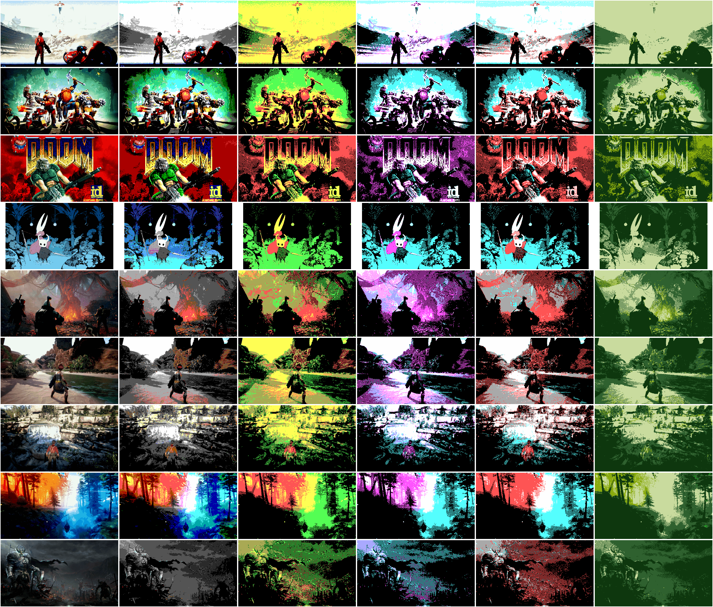

# retrogfx
a CLI tool to compute and/or apply a palette to multiple images

## Build
Requires xmake and raylib for build.
Build:
```
xmake
```
Build and run:
```
xmake run retrogfx <parameters...>
```

## Command line
```
retrogfx -h                    
Options:
  -h [ --help ]         produce help
  -d [ --div ] arg      resolution divider
  -c [ --colors ] arg   color count
  -p [ --palette ] arg  palette image or either predefined value CGA0, CGA1, CGA5 or EGA
```

## Examples
* Compute one shared palette of 64 colors from all images and divide resolution by 5:
```
retrogfx -c 64 -d 5 input/*.png
```
* Apply EGA palette to all images:
```
retrogfx -p EGA input/*.png
```

## Samples
From left to right: VGA (one shared 256 colors palette computed from all input images), EGA, three different CGA palettes

